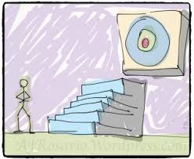

## Who am I? 

I'm Erfan,
An enthusiastic programmer and self-motivated learner born in Iran.

I've worked in the Games Industry for ~2 Years, My first Job was Unity3D programmer but **I didn't wanted to use Unity, I wanted to help make It**.
and my second job was C++ Programmer I used imgui to develop app ui and sometimes I had to work with dx and opengl stuff but I never had chance to understand them.

I'm a student of Computer Science at Shahid Beheshti Unversity, I think University is a waste of time for me except it forces me to learn good stuff sometimes.

In my case, Hello Triangle

### I Love...
- Learning 
- Low-Level Graphics Programming
- Applying Math to my Programs, simply I love math :) 
- Writing high-performance applications 
- Data-Oriented programming.
- Living Healthy
- Converstation with people about their passion
- Gaming, such little time to play all these exciting new games. currently on Detroit: Become Human on PS4 about a month now.
- Playing guitar. started it exactly a year ago but still a complete beginner.

### What are my experiences?
- Programming C++ for a lot of time now. Started  C++ ~2013 on and off but everyday programming since 2017)
- Worked and did some Unity3D projects with C#.
- PlayPod PC Client (Cloud Gaming Platform in Iran)
- Played around with dear ImGui a lot
- Tried to write a 2D Game Engine over DirectX 11 with a friend of mine 3 years ago, but I didn't do any DirectX work, just math, and physics stuff
- Multi-threading experiences with TBB, C++ Standard Lib and most recently trying OpenMP (boy multi-threading is so energy consuming, I love it)
- Other unrelated stuff: Apps with Java, Some games with python, Android programming

### What is this Blog For? 

I started this blog to make a commitment to achieve Goals, short-term or long-term goals and write my journey as someone who has little experience in Graphics API's and barely knows about the Graphics Pipeline.

I will try to post C++ and my work-related stuff too,

### What are my Goals about?

Well, right now I'm starting to learn Vulkan API and writing Shaders and try to make a Pro graphics programmer out of my self. Also, I have Data-oriented programming, Unreal Engine, CUDA, OpenCL and a lot of other stuff in mind.

You can find me on:
- [GitHub](https://github.com/Erfan-Ahmadi)
- [Twitter](https://twitter.com/ahmadierfan999)

<b>
 Hope You'll enjoy this blog :)
</b>

Date of the actual writing: April 04, 2019
